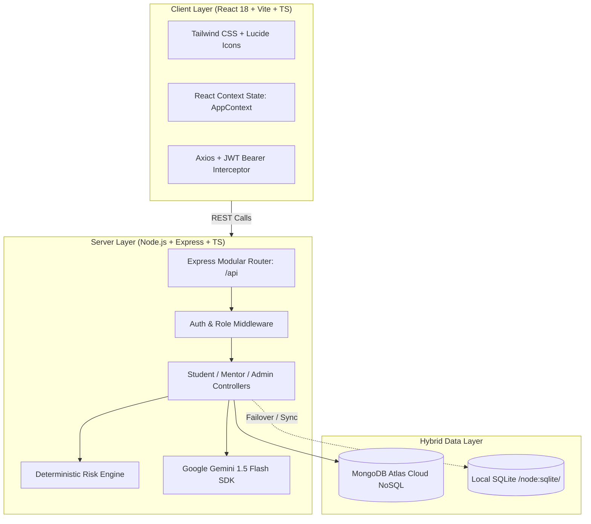
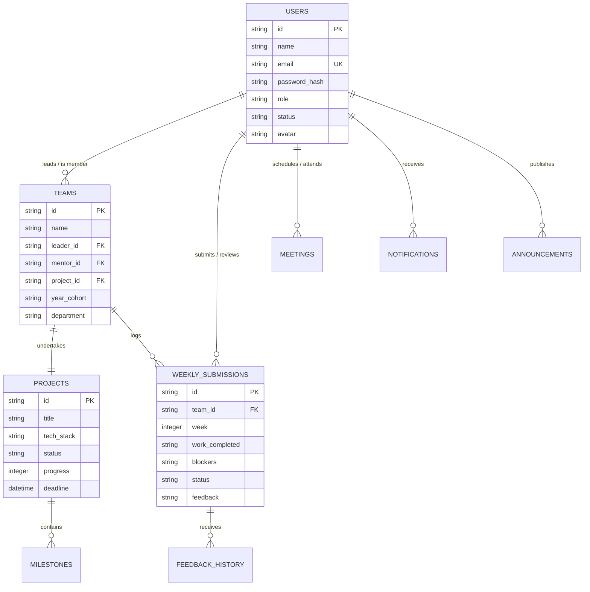
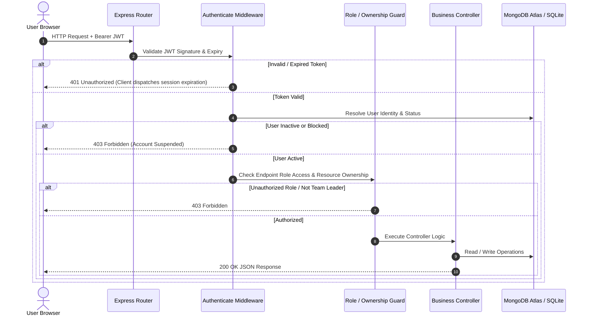

# ProjectMentor (Project Pulse) — Comprehensive Technical & Architectural Project Report

**Document Version:** 1.0.0  
**Project Name:** ProjectMentor / Project Pulse  
**System Classification:** Academic Project Lifecycle Monitoring & Mentorship Platform  
**Target Operating Environment:** Node.js (>=22.5.0), React 18, Vite, TypeScript, MongoDB Atlas & SQLite  
**Generated Date:** March 2025  

---

## Table of Contents

1. [Executive Summary](#1-executive-summary)
2. [Problem Statement & Solution Architecture](#2-problem-statement--solution-architecture)
3. [Technology Stack & Key Dependencies](#3-technology-stack--key-dependencies)
4. [High-Level System Architecture](#4-high-level-system-architecture)
5. [Database Design & Dual-Persistence Architecture](#5-database-design--dual-persistence-architecture)
6. [Authentication, Authorization & Security Architecture](#6-authentication-authorization--security-architecture)
7. [Role-Governed Functional Modules](#7-role-governed-functional-modules)
   - [7.1 Student Workspace](#71-student-workspace)
   - [7.2 Faculty Mentor Workspace](#72-faculty-mentor-workspace)
   - [7.3 Administrator Control Center](#73-administrator-control-center)
8. [Deterministic Heuristic Engine & Gemini AI Service](#8-deterministic-heuristic-engine--gemini-ai-service)
9. [Comprehensive REST API Catalog](#9-comprehensive-rest-api-catalog)
10. [Deployment, Infrastructure & Operations](#10-deployment-infrastructure--operations)
11. [Default Seed Credentials & Test Environment](#11-default-seed-credentials--test-environment)
12. [Strengths, Current Limitations & Strategic Roadmap](#12-strengths-current-limitations--strategic-roadmap)

---

## 1. Executive Summary

**ProjectMentor** (internally designated as *Project Pulse*) is an enterprise-grade academic project governance platform developed for colleges and universities. It bridges the communication and tracking divide between **undergraduate/postgraduate engineering student teams**, **faculty mentors**, and **departmental academic administrators**.

Traditional college capstone and mini-project workflows rely on disparate spreadsheets, fragmented email threads, and infrequent physical logbook reviews. This results in late detection of off-track teams, unmonitored code commits, review bottlenecks, and subjective risk assessment.

ProjectMentor resolves this through:
- **Role-Based Workspaces:** Dedicated interfaces tailored for Students, Mentors, and Administrators.
- **Weekly Progress Cadence:** Structured weekly submissions tracking completed work, ongoing tasks, blockers, and next week goals with attachments and repository tracking.
- **Hybrid Dual-Engine Storage:** MongoDB Atlas (primary cloud NoSQL) combined with Node.js native SQLite (`node:sqlite` in WAL mode) for automatic fallback and zero-downtime offline resiliency.
- **Deterministic Risk Scoring:** A mathematical heuristic engine that evaluates cadence delay, deadline proximity, GitHub activity, and review backlogs without arbitrary black-box outputs.
- **Google Gemini 1.5 Flash AI Insights:** Grounded generative synthesis that contextualizes deterministic risk into natural-language executive summaries and actionable mentor advisories.

---

## 2. Problem Statement & Solution Architecture

### 2.1 The Academic Pain Points

| Challenge | Real-World Impact | ProjectMentor Solution |
| :--- | :--- | :--- |
| **Silent Failures** | Teams delay progress reports until the final weeks, failing capstone evaluations. | Mandatory weekly cadence with overdue detection and automatic risk flags. |
| **Mentor Workload Overload** | Mentors supervising 10+ teams struggle to manually track diffs and blocker trends. | Consolidated dashboard displaying review queues, project progress donuts, and one-click reviews. |
| **Disjointed Artifact Storage** | Documentation, slides, and links get lost in email chains and chat apps. | Centralized submission repository linking GitHub repos, attachments, and historical review logs. |
| **Inconsistent Allocation** | Department administrators lack visibility into mentor loading and unassigned teams. | Admin allocation portal with live mentor load balancing and cohort filtering. |
| **Connection & Network Instabilities** | Cloud DB whitelist constraints or college Wi-Fi drops take down demo servers. | Hybrid dual-write architecture with automatic local SQLite fallback. |

---

## 3. Technology Stack & Key Dependencies



### 3.1 Technology Specifications

- **Runtime & Language:** Node.js `>=22.5.0`, TypeScript `5.6.3`.
- **Frontend Framework:** React `18.3.1` bundled with Vite `5.4.9`.
- **Styling & UI Components:** Tailwind CSS `3.4.14`, PostCSS, Lucide React `0.453.0`, Clsx, Tailwind-Merge.
- **Backend Framework:** Express `4.21.1` with `express-rate-limit` and CORS.
- **Database (Primary):** MongoDB Atlas via Mongoose `8.24.7`.
- **Database (Resilient Fallback):** Node.js native `node:sqlite` (DatabaseSync) with WAL journal mode.
- **Artificial Intelligence:** `@google/generative-ai` `0.21.0` utilizing `gemini-1.5-flash`.
- **Security & Cryptography:** `bcryptjs` `2.4.3` (10 salt rounds), `jsonwebtoken` `9.0.2` (HS256 with 7-day expiration).
- **Process Orchestration:** `concurrently` `8.2.2`, `tsx` `4.19.1` for hot-reloading TypeScript.

---

## 4. High-Level System Architecture

```
project-mentors/
├── api/                           # Vercel serverless integration entrypoint
│   └── index.js
├── client/                        # React SPA (Vite + TypeScript)
│   ├── src/
│   │   ├── api/                   # Typed Axios API client & endpoints
│   │   ├── components/            # Layouts, Navbars, Sidebars, Donut charts, Modals
│   │   ├── context/               # Global AppContext (Session, Teams, Projects)
│   │   ├── data/                  # Mock and structural typings
│   │   ├── hooks/                 # Custom React data hooks (useFetch)
│   │   ├── types/                 # Domain interface definitions
│   │   ├── views/                 # 14 Role-specific views & pages
│   │   ├── App.tsx                # Client routing and view switchboard
│   │   └── main.tsx               # Client entrypoint
│   ├── tailwind.config.js
│   └── vite.config.ts
├── docs/                          # Architecture blueprints & specs
│   └── ARCHITECTURE.md
├── server/                        # Express REST Backend (TypeScript)
│   ├── src/
│   │   ├── config/                # Database connection & MongoDB diagnostics
│   │   ├── controllers/           # Admin, Auth, Mentor, Student, Team, Review controllers
│   │   ├── db/                    # SQLite initialization & database seeder
│   │   ├── middleware/            # JWT authentication, role verification, ownership
│   │   ├── models/                # Mongoose Schema definitions (User, Team, Project, etc.)
│   │   ├── routes/                # Express API Route declarations
│   │   ├── scripts/               # Admin bootstrap and CLI utilities
│   │   ├── services/              # Deterministic Risk Engine & Gemini AI service
│   │   ├── app.ts                 # Express app setup, CORS, error handling
│   │   └── server.ts              # Server startup & port binding
│   ├── render.yaml                # Render cloud deployment blueprint
│   └── tsconfig.json
├── PROJECT_REPORT.md              # Complete Project Analysis & Documentation
├── README.md                      # Overview & Curriculum Guide
└── vercel.json                    # Vercel fullstack SPA routing configuration
```

---

## 5. Database Design & Dual-Persistence Architecture

### 5.1 The Hybrid Dual-Storage Pattern

A standout technical achievement of ProjectMentor is its **Zero-Downtime Dual Storage Model**:
1. When **MongoDB Atlas** is accessible, the system writes to MongoDB as the primary document store and mirrors essential entities into SQLite.
2. If MongoDB Atlas experiences network timeouts, DNS resolution issues, or IP whitelist restrictions (common on changing student Wi-Fi or college firewalls), the server **does not crash**.
3. Instead, the backend automatically transitions to **SQLite Active Storage Mode** using Node's built-in `node:sqlite`. A background retry daemon periodically checks for MongoDB Atlas availability without interrupting user operations.

### 5.2 SQLite Schema Model



### 5.3 Mongoose Schemas

- **`User`:** Full name, normalized lowercase email, bcrypt hash (excluded from queries by default), role (`STUDENT`, `MENTOR`, `ADMIN`), status (`ACTIVE`, `BLOCKED`), department, year, college, avatar URL, mustChangePassword flag.
- **`Team`:** Team name, year cohort (`1st Year`, `2nd Year`, `3rd Year`), leader ID reference, member ID array, mentor ID reference, department.
- **`Project`:** Title, description, tech stack array, team reference, GitHub repo URL, current phase, deadline, progress percentage (0–100), health status (`ON_TRACK`, `NEEDS_ATTENTION`, `DELAYED`, `COMPLETED`), nested milestone sub-documents.
- **`Progress`:** Team reference, project reference, week number, completed tasks array, ongoing work, blockers array, next week goals array, file attachments, repo URL, reviewer reference, status (`SUBMITTED`, `APPROVED`, `NEEDS_IMPROVEMENT`, `MAJOR_ISSUE`).
- **`Review`:** Progress ID reference, team ID, mentor ID, review decision (`Approved`, `Needs Improvement`, `Major Issue`), feedback body, timestamp.

---

## 6. Authentication, Authorization & Security Architecture

### 6.1 Multi-Layered Security Pipeline



### 6.2 Key Security Measures

1. **JWT Authentication:** Strict Bearer token extraction, HMAC-SHA256 signature verification, and 7-day lifespan.
2. **Password Security:** Multi-round bcrypt salt generation (10 rounds). Passwords are never returned in JSON payloads (`select: false` in Mongoose, excluded in SQLite queries).
3. **Google OAuth Integration:** Flexible sign-in workflow supporting official Google ID tokens or profile payloads with role verification.
4. **Mandatory Password Change:** When an administrator invites a new mentor or student with a default password, `mustChangePassword` prompts an immediate change before accessing dashboards.
5. **Ownership Enforcement:** Non-leader students can browse and view team progress, but only the designated **Team Leader** (`verifyTeamLeaderOwnership`) can submit official weekly progress reports.
6. **CORS Whitelisting:** Regex rules allowing Vercel preview environments, production deployment domains, and local development hosts without dropping preflight OPTIONS requests.
7. **Path Traversal Sanitization:** The file serving route (`/api/files/:filename`) strips non-alphanumeric characters to prevent directory traversal exploits.

---

## 7. Role-Governed Functional Modules

### 7.1 Student Workspace

- **Academic Dashboard (`StudentDashboardView.tsx`):**
  - Displays student profile, roll number, department, academic cohort, and institution.
  - Interactive SVG progress donut showing current project completion percentage.
  - Phase badges (e.g. "Development Phase", "Milestone 3/5").
  - Latest submission status banner with direct mentor feedback, reviewer avatar, and approval timestamp.
- **My Teams View (`MyTeamsView.tsx`):**
  - Cohort filter tabs: *All*, *1st Year*, *2nd Year*, *3rd Year*.
  - Team search engine filtering by team title, project title, or team leader name.
  - "Create Team" modal allowing students to register a project title, tech stack tags, repository URL, and cohort.
  - "Join Team" button enabling students without a team to join existing project groups.
- **Project Details View (`ProjectDetailsView.tsx`):**
  - Multi-tab breakdown: *Overview*, *Team*, *Progress*, *Timeline*, *Files*, *Reviews*.
  - GitHub repository link button with commit tracking badges.
  - Milestone timeline displaying *Completed*, *In Progress*, and *Pending* milestones.
- **Weekly Progress Submission (`SubmitProgressView.tsx`):**
  - Auto-calculates next submission week number.
  - Structured entry fields: Completed work, current week focus, blockers/impediments, next week commitments.
  - Drag-and-drop file uploader supporting PDFs, images, presentations, and archives up to 10MB.
  - Repository URL synchronization.
- **Project Analytics (`ProjectAnalyticsView.tsx`):**
  - High-level cohort health cards (Total Teams, On Track %, Needs Attention %, Delayed %).
  - Progress distribution chart.

---

### 7.2 Faculty Mentor Workspace

- **Mentor Dashboard (`MentorDashboardView.tsx`):**
  - Quick-metric cards: *Assigned Teams Count*, *Students Guided*, *Pending Reviews*, *Upcoming Meetings*.
  - Overdue submission alerts highlighting teams that missed submission deadlines.
  - Real-time activity feed showing submission timestamps and review actions.
- **My Assigned Teams (`MentorPages.tsx` - `MentorTeamsView`):**
  - Grid listing teams allocated to this mentor.
  - One-click inspection launching `MentorTeamDetails.tsx`.
- **Team Inspection Modal (`MentorTeamDetails.tsx`):**
  - Full project summary, technology stack badges, and GitHub link.
  - Milestone list with interactive status checkmarks.
  - Complete historical weekly submission log with submitted text, files, and review histories.
  - Integrated **Risk Analysis & AI Assessment** section detailing deterministic risk points and Gemini summary insights.
- **Progress Review Queue (`MentorPages.tsx` - `MentorReviewsView`):**
  - Filterable review desk showing *Pending*, *Approved*, and *Changes Requested*.
  - Review modal with evaluation actions: **Approve** or **Request Changes** with 500-character structured feedback.
- **Meeting Scheduler (`MentorPages.tsx` - `MentorMeetingsView`):**
  - Schedule synchronous virtual (Google Meet / Zoom) or physical lab meetings with specific teams.
  - Date, time, meeting link/location, and agenda notes.
- **Mentor Profile (`MentorPages.tsx` - `MentorProfileView`):**
  - Update faculty title, department, contact phone, and mentorship research bio.

---

### 7.3 Administrator Control Center

- **Institutional Overview (`AdminDashboardView.tsx`):**
  - Metric summary: Total Students, Total Mentors, Total Teams, Active Projects, Unassigned Teams.
  - Rapid shortcuts: Add Mentor, Allocate Mentors, Broadcast Announcement.
- **Student Directory (`AdminPages.tsx` - `AdminStudentsView`):**
  - Complete student roster with roll numbers, cohort, department, team status, and account state.
  - Search by name or email; filter by active/inactive status.
  - One-click account suspension/reactivation with confirmation modal.
- **Faculty Mentor Directory (`AdminPages.tsx` - `AdminMentorsView`):**
  - Faculty directory displaying department, title, assigned teams count, and contact details.
  - "Add Mentor" workflow: auto-generates credentials and default password (`siet@2727`), with one-click credential copying for email distribution.
  - Edit faculty profile or update status (Active/Inactive).
- **Team & Mentor Allocation Desk (`AdminPages.tsx` - `AdminTeamsView` & `AdminAssignMentorsView`):**
  - View all student teams across academic cohorts.
  - Filter teams by unassigned status.
  - Reassign or allocate faculty mentors from a dropdown list with instantaneous database synchronization.
- **Institutional Announcements (`AdminPages.tsx` - `AdminAnnouncementsView`):**
  - Broadcast administrative notices with targeted audience selectors (`All`, `Students Only`, `Mentors Only`).
- **Institutional Reports & Settings (`AdminPages.tsx` - `AdminReportsView` & `AdminSettingsView`):**
  - Departmental progress velocity, risk distribution pie graphs, and completion metrics.
  - Global system settings: Academic Year label, student team registration toggles, and default submission intervals.

---

## 8. Deterministic Heuristic Engine & Gemini AI Service

### 8.1 The Two-Tier Assessment Architecture

ProjectMentor combines **transparent deterministic rules** with **generative contextual AI**:

```
[Team Submission & Repo Activity]
               │
               ▼
┌─────────────────────────────────────────┐
│     DETERMINISTIC HEURISTIC ENGINE      │
│          (server/src/services/          │
│             riskService.ts)             │
│                                         │
│ • Cadence Stagnation (>7d: +15, >10d:+35)│
│ • Deadline Risk (<=10d & <50%: +40)     │
│ • Low VCS Activity (0 commits: +15)     │
│ • Review Backlog (>3d: +10)             │
└─────────────────────────────────────────┘
               │
               ▼
  Calculated Score: 0 - 100
  Status: ON_TRACK | NEEDS_ATTENTION | DELAYED | COMPLETED
  Risk Level: LOW | MEDIUM | HIGH
               │
               ▼
┌─────────────────────────────────────────┐
│     GOOGLE GEMINI 1.5 FLASH ENGINE      │
│          (server/src/services/          │
│            geminiService.ts)            │
│                                         │
│ • Ground truth deterministic inputs     │
│ • Empathetic academic mentor persona    │
│ • Synthesizes executive summary         │
│ • Identifies project strengths          │
│ • Recommends concrete mentor actions    │
└─────────────────────────────────────────┘
               │
               ▼
  Structured JSON Output Displayed in Mentor Team Details
```

### 8.2 Deterministic Risk Matrix

| Risk Factor | Trigger Condition | Score Penalty | Generated Warning Flag |
| :--- | :--- | :--- | :--- |
| **Cadence Stagnation** | Days since last update $> 10$ | **+35 pts** | `Inactivity: No updates recorded for X days` |
| **Cadence Warning** | Days since last update $> 7$ | **+15 pts** | `Cadence warning: X days since last update` |
| **Imminent Deadline Breach** | Deadline $\le 10$ days AND progress $< 50\%$ | **+40 pts** | `Deadline breach risk: X days left with only Y% complete` |
| **Tight Delivery Window** | Deadline $\le 14$ days AND progress $< 70\%$ | **+20 pts** | `Tight delivery window: X days remaining` |
| **Zero Repository Activity** | Commits this week $= 0$ | **+15 pts** | `Low VCS activity: 0 commits detected this week` |
| **Review Bottleneck** | Submission pending review $> 3$ days | **+10 pts** | `Review backlog: Pending mentor evaluation` |

**Classification Thresholds:**
- **Score $\ge 50$:** Status = `DELAYED`, Risk Level = `HIGH`
- **Score $25 - 49$:** Status = `NEEDS_ATTENTION`, Risk Level = `MEDIUM`
- **Score $0 - 24$:** Status = `ON_TRACK`, Risk Level = `LOW`
- **Progress $\ge 100\%$:** Status = `COMPLETED`, Risk Level = `LOW` (Score: 0)

### 8.3 Gemini Generative Prompt Design

The Gemini service enforces strict guidelines:
1. Gemini **never** calculates or modifies the numerical score or status; the deterministic output is injected as immutable ground truth.
2. If `GEMINI_API_KEY` is not configured or an API error occurs, an automatic rule-based fallback produces an informative summary without failing the request.

---

## 9. Comprehensive REST API Catalog

All endpoints are prefixed with `/api` (or mounted directly on `/` to support proxying).

### 9.1 Authentication Endpoints (`/api/auth`)

| Method | Endpoint | Access | Purpose & Input Payload |
| :--- | :--- | :--- | :--- |
| `POST` | `/api/auth/register` | Public | Student signup (`name`, `email`, `password`, `department`, `year`, `college`). |
| `POST` | `/api/auth/login` | Public | User authentication (`email`, `password`). Returns JWT, user record, redirect URL. |
| `POST` | `/api/auth/google` | Public | Google OAuth token/profile authentication. Returns JWT and user record. |
| `GET` | `/api/auth/me` | Authenticated | Validates session token and returns fresh user profile data. |
| `POST` | `/api/auth/change-password` | Authenticated | Password update (`currentPassword`, `newPassword`). |
| `POST` | `/api/auth/logout` | Authenticated | Server-side logout acknowledgement and token invalidation. |

### 9.2 Student Endpoints (`/api/student`)

| Method | Endpoint | Access | Purpose & Input Payload |
| :--- | :--- | :--- | :--- |
| `GET` | `/api/student/dashboard` | Student | Returns student profile, team, project, milestones, and all weekly submissions. |
| `GET` | `/api/student/teams` | Student | Lists all active student teams across academic cohorts with leader and mentor info. |
| `POST` | `/api/student/teams` | Student | Creates a new team and project (`name`, `projectTitle`, `description`, `techStack`, `yearCohort`). |
| `POST` | `/api/student/teams/:id/join` | Student | Joins an existing team as a member. |
| `POST` | `/api/student/submissions` | Student (Leader) | Submits weekly progress report (`weekNumber`, `workCompleted`, `blockers`, `repoUrl`, `files`). |

### 9.3 Faculty Mentor Endpoints (`/api/mentor`)

| Method | Endpoint | Access | Purpose & Input Payload |
| :--- | :--- | :--- | :--- |
| `GET` | `/api/mentor/dashboard` | Mentor | Returns summary metrics, assigned teams, pending reviews, and upcoming meetings. |
| `GET` | `/api/mentor/teams` | Mentor | Retrieves all student project teams assigned to the authenticated faculty member. |
| `GET` | `/api/mentor/teams/:id` | Mentor | Fetches complete team workspace, members, submissions, and AI risk analysis. |
| `GET` | `/api/mentor/projects` | Mentor | Searches and filters projects supervised by this mentor. |
| `GET` | `/api/mentor/reviews` | Mentor | Lists submissions pending evaluation or reviewed by this mentor. |
| `POST` | `/api/mentor/reviews/:id` | Mentor | Submits review feedback (`action`: `'APPROVE'` \| `'CHANGES_REQUESTED'`, `feedback`). |
| `GET` | `/api/mentor/meetings` | Mentor | Retrieves scheduled meetings for this mentor. |
| `POST` | `/api/mentor/meetings` | Mentor | Schedules a new sync meeting (`teamId`, `title`, `date`, `time`, `linkOrLocation`, `notes`). |
| `GET` | `/api/mentor/notifications` | Mentor | Fetches unread and read alerts for submissions and events. |
| `PUT` | `/api/mentor/notifications/:id/read` | Mentor | Marks a notification as read. |
| `PUT` | `/api/mentor/profile` | Mentor | Updates faculty profile details (`department`, `title`, `bio`, `phone`, `name`). |

### 9.4 Administrator Endpoints (`/api/admin`)

| Method | Endpoint | Access | Purpose & Input Payload |
| :--- | :--- | :--- | :--- |
| `GET` | `/api/admin/dashboard` | Admin | Institutional metrics, total counts, status breakdown, and recent activity logs. |
| `GET` | `/api/admin/students` | Admin | Roster of students with optional `search` and `status` query parameters. |
| `PUT` | `/api/admin/students/:id/status`| Admin | Toggles student account state (`status`: `'active'` \| `'inactive'`). |
| `GET` | `/api/admin/mentors` | Admin | Roster of faculty mentors with assigned team counts and contact details. |
| `POST` | `/api/admin/mentors` | Admin | Creates a new mentor account (`name`, `email`, `department`, `title`). |
| `PUT` | `/api/admin/mentors/:id` | Admin | Updates mentor profile details (`name`, `department`, `title`, `phone`, `bio`). |
| `PUT` | `/api/admin/mentors/:id/status` | Admin | Toggles mentor account state (`status`: `'active'` \| `'inactive'`). |
| `GET` | `/api/admin/teams` | Admin | Paginated teams list with mentor filter and search capabilities. |
| `PUT` | `/api/admin/teams/:id/assign-mentor` | Admin | Assigns or reallocates a faculty mentor to a student team (`mentorId`). |
| `GET` | `/api/admin/projects` | Admin | Institutional projects overview with status filters. |
| `GET` | `/api/admin/announcements` | Admin | Lists institutional announcements. |
| `POST` | `/api/admin/announcements` | Admin | Publishes announcement (`title`, `message`, `audience`: `'all'` \| `'students'` \| `'mentors'`). |
| `GET` | `/api/admin/reports` | Admin | Generates institutional velocity, risk distribution, and completion statistics. |
| `GET` | `/api/admin/settings` | Admin | Fetches system-wide configuration keys and values. |
| `PUT` | `/api/admin/settings` | Admin | Saves system-wide configuration changes. |

### 9.5 File Serving & Health (`/api/files`, `/api/health`)

| Method | Endpoint | Access | Purpose |
| :--- | :--- | :--- | :--- |
| `GET` | `/api/health` | Public | System health check reporting uptime, service name, and MongoDB Atlas diagnostics. |
| `GET` | `/api/files/:filename` | Authenticated | Secure file delivery serving inline documents or lightweight PDF stubs. |

---

## 10. Deployment, Infrastructure & Operations

### 10.1 Monorepo Build Scripts

The root `package.json` coordinates server and client workflows:
- `npm run install:all`: Recursively installs dependencies across root, `server/`, and `client/`.
- `npm run dev`: Executes `concurrently` running the backend hot-reloader (`tsx watch src/server.ts`) and the frontend dev server (`vite`).
- `npm run build`: Compiles TypeScript for the server (`tsc`) and bundles the React SPA (`tsc && vite build`).
- `npm start`: Starts the compiled production backend server (`node dist/server.js`).
- `npm run db:seed`: Seeds verified administrator, mentor, and student test accounts into the database.
- `npm run admin:setup`: Interactive or automated CLI tool to provision administrative users.
- `npm run test:mongo`: Diagnostics script to test MongoDB Atlas connectivity and DNS resolution.

### 10.2 Production Deployment Configurations

1. **Vercel (`vercel.json`):**
   - Configured for fullstack deployment where `client/dist` serves the static single-page application.
   - API calls (`/api/(.*)`) route to the serverless wrapper `api/index.js`.
   - Single-page application fallbacks (`/(.*)`) route to `/index.html`.
2. **Render (`render.yaml`):**
   - Configured as a background web service running Node.js 22.
   - Sets working directory to `server`, builds with `npm install && npm run build`, and executes `npm start`.

---

## 11. Default Seed Credentials & Test Environment

The database seeder (`server/src/db/seed.ts`) initializes three default accounts across all supported storage engines:

| Role | Primary Email | Academic Fallback Email | Default Password | Initial State |
| :--- | :--- | :--- | :--- | :--- |
| **Administrator** | `admin@gmail.com` | `admin@college.edu` | `siet@2727` | Verified active admin |
| **Faculty Mentor** | `vetri@gmail.com` | `vetri@college.edu` | `siet@2727` | Dr. Vetri Chelvan (CS Dept) |
| **Student** | `vijay@gmail.com` | `vijay@college.edu` | `siet@2727` | Vijay Ananth R S (3rd Year) |

---

## 12. Strengths, Current Limitations & Strategic Roadmap

### 12.1 Project Strengths

1. **Exceptional Storage Resilience:** The dual MongoDB Atlas + SQLite architecture prevents local development and deployment downtime caused by institutional network blocks.
2. **Transparent Risk Heuristics:** Ground-truth deterministic rules prevent unpredictable AI hallucinations when assessing critical academic deadlines.
3. **Comprehensive RBAC Coverage:** Clean separation of concerns between Students, Mentors, and Department Administrators.
4. **Modern UI Design System:** Clean dashboard aesthetics utilizing Tailwind CSS, Lucide icons, responsive navigation sidebars, and accessible modal dialogs.
5. **Production Readiness:** Configured and validated for immediate deployment on Vercel and Render.

### 12.2 Current Limitations

1. **File Storage Backend:** Files are currently stored locally or delivered as stream stubs; integrating AWS S3 or Cloudinary would improve large document handling.
2. **Real-Time WebSockets:** Updates currently rely on optimistic UI updates and polling; Socket.io could provide live notifications.
3. **GitHub API Token Integration:** Commits are calculated via metadata inputs; direct GitHub webhook integration would automate commit verification.

### 12.3 Strategic Roadmap

- **Phase 1 (Immediate):**
  - Integrate Cloudinary or AWS S3 signed URLs for PDF capstone report uploads.
  - Add CSV/Excel roster import for batch onboarding of student cohorts.
- **Phase 2 (Mid-Term):**
  - Webhook integration with GitHub / GitLab for automatic commit counting and PR tracking.
  - Automated calendar synchronization for Google Meet and Outlook faculty reviews.
- **Phase 3 (Long-Term):**
  - Automated rubric-based rubric grading generation for university accreditation audits (e.g. ABET / NBA).
  - Multi-college tenant partitioning for university-wide rollout.

---

*Report prepared and certified for ProjectMentor (Project Pulse).*
